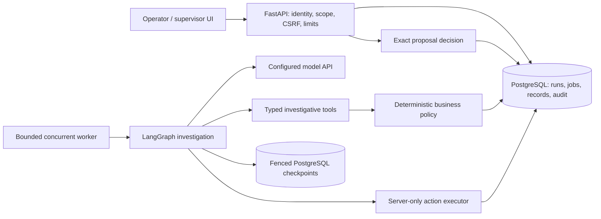

# ResolveFlow

**A support operations agent that investigates orders, asks for missing evidence, and pauses for approval before changing business records.**

[Try the live app](https://resolveflow-wojr.onrender.com) · [Architecture](docs/ARCHITECTURE.md) · [Evaluation](docs/EVALUATION.md) · [API guide](docs/API.md)

ResolveFlow combines model-selected tools with deterministic business rules and a durable PostgreSQL workflow. It handles damaged-item replacements, eligible refunds, cancellations, and read-only order-status questions. Every customer, order, payment and business action is fictional.

## Try the complete workflow

1. Open the live app and select **Try the live workflow**. You receive your own isolated workspace and three fresh orders; no password is required for the public sandbox.
2. Select **Damaged item**, **Delayed order**, **Cancellation**, or **Order status** to populate a request using your actual sandbox order IDs. You can also write your own request.
3. Choose **AI investigation** and submit. Watch persisted observations appear as the worker inspects the order, shipment and policy. Missing information produces a clarification form.
4. For an eligible business action, inspect the exact proposal. Switch to **Demo supervisor**, select the request, and approve or reject it.
5. Inspect **Sandbox records**. An approval creates a linked ledger entry only after the worker rechecks the policy, evidence, approval and current order revision. A rejection creates no effect.

Public role switching is an interactive demonstration inside your own fictional workspace. Named operator, supervisor and developer accounts are separate from public demo access. Free hosting can sleep when idle; an initial load may take longer. Queued state survives instance restarts.

## What the model does

The model selects typed investigative tools, interprets the request, and asks for missing information. Application code authorizes customer access, enforces policy, binds evidence to proposals, records supervisor decisions, and executes protected actions.

The hosted preference is **Gemini 3.8 Flash**. Its published input window is 1,048,576 tokens, and Google offers a free tier. The application keeps its own smaller context, turn, token and time budgets. The configured free fallbacks are **Gemini 3.6 Flash** and **Gemini 3.5 Flash-Lite**. Daily model-quota exhaustion can select another configured model; the execution details and provider events record the model actually used. Context from a different model is carried as observed data, without replaying its opaque thought signatures.

Free allowances are account-specific. The integration check encountered a 20-request daily allowance for Gemini 3.8 Flash; one investigation uses several requests. This is why an exhausted preferred model does not make the entire demo unusable. There is no automatic switch to a paid model or scripted fixture.

Sources: [Gemini model capabilities](https://ai.google.dev/gemini-api/docs/models/gemini-3.8-flash), [free-tier pricing](https://ai.google.dev/gemini-api/docs/pricing), [account quotas](https://ai.google.dev/gemini-api/docs/rate-limits).

| Mode | Decision source | Purpose |
| --- | --- | --- |
| `provider` | Real configured model tool calls | Interactive AI investigations and live integration checks |
| `baseline` | Conservative, inspectable rules | Reproducible reference workflow; ambiguity asks a question |
| `fixture` | Scripted adapter | Credential-free plumbing and recovery tests |

Baseline and fixture share code and are not independent competing AI systems. A successful scripted run is not evidence of model reasoning quality.

## Architecture



One modular Python application, a separately supervised worker process, and PostgreSQL. The worker can investigate two independent requests concurrently by default; each delivery owns its checkpoint connection. Model scheduling is bounded, and provider calls do not hold business transactions open.

### Reliability properties

- **Exact approval:** the decision binds to an immutable proposal hash, workspace, revisions and expiry. Developer access does not grant supervisor permission.
- **Fresh execution checks:** the executor locks the order and rechecks its revision, current policy and evidence before committing.
- **Cumulative refund limits:** a shipping refund cannot exceed the remaining unrefunded shipping fee, including refunds from other investigations.
- **Atomic sandbox effects:** the order update, ledger operation, approval consumption, effect and audit event commit in one transaction.
- **Replay protection:** repeated delivery of an operation returns the committed result. A reused key with a different payload conflicts.
- **Human-input recovery:** a clarification or approval that arrives before its interrupt checkpoint is handled on replay instead of waiting for another reply.
- **Relevant evidence:** an eligibility citation must match the proposed order, action parameters, facts and order revision; the support case must match the proposal.
- **Useful failure paths:** missing business records escalate, partial clarification preserves remaining questions, expired approvals are retired, and failed or stale investigations can be started afresh with a new proposal and approval.

These guarantees apply to the fictional effects committed in this PostgreSQL database. A real payment or shipping integration would additionally need provider idempotency keys and reconciliation for ambiguous external outcomes. ResolveFlow does not claim distributed exactly-once execution.

## Run locally

Requirements: Python 3.12, [uv](https://docs.astral.sh/uv/), and Docker with Compose.

```bash
git clone https://github.com/cyash24f3/resolveflow.git
cd resolveflow
uv sync --frozen
uv run python scripts/bootstrap.py
docker compose up -d --build
```

Open [localhost:8090](http://localhost:8090). The local demo has operator, supervisor and developer role buttons. Bootstrap generates distinct private credentials in `.env` and preserves existing settings. Compose binds public ports to loopback. Database state is stored in a named volume.

To run the Python processes directly with only PostgreSQL in Docker:

```bash
docker compose up -d db
uv run python -m resolveflow.cli init
uv run uvicorn resolveflow.api.app:app --host 127.0.0.1 --port 8090
# In another terminal:
uv run python -m resolveflow.jobs.worker
```

Stop with `docker compose down`. Removing the volume with `down -v` deletes local data.

### Enable real inference

Use a Google AI Studio project on the free tier. Put the key in your private `.env`, then set:

```dotenv
PROVIDER_ENABLED=true
PROVIDER_BASE_URL=https://generativelanguage.googleapis.com/v1beta/openai
DOCKER_PROVIDER_BASE_URL=https://generativelanguage.googleapis.com/v1beta/openai
PROVIDER_MODEL=gemini-3.8-flash
PROVIDER_FALLBACK_MODELS=["gemini-3.6-flash","gemini-3.5-flash-lite"]
PROVIDER_REASONING_EFFORT=medium
PROVIDER_MAX_OUTPUT_TOKENS=4096
PROVIDER_MIN_INTERVAL_SECONDS=6
```

Set `PROVIDER_API_KEY` privately; never commit it. Restart the API and worker after configuration changes. For local Ollama, configure its OpenAI-compatible endpoint and installed tool-capable model instead; clear the hosted fallback list and reasoning setting if unsupported. An unavailable provider produces a visible failure rather than simulated model output.

## Verify

```bash
uv run ruff check src tests scripts migrations
uv run ruff format --check src tests scripts migrations
uv run mypy src
uv run pytest -q
uv run python -m resolveflow.evaluation.runner --split ci --systems baseline fixture
uv run python scripts/recovery_demo.py
```

Tests create isolated PostgreSQL schemas and remove them afterwards. They do not reset your demo workspace. The database role must be allowed to create schemas. CI supplies disposable PostgreSQL and never calls a paid model.

The regression suite covers approval/clarification checkpoint races, separate shipping-refund requests, misleading and negated intent, partial facts, mismatched evidence, missing records, logout revocation, named identities, public-workspace isolation, body limits, throttling, and stale-investigation recovery.

For the larger deterministic evaluation:

```bash
uv run python -m resolveflow.evaluation.runner --split development --systems baseline
uv run python -m resolveflow.evaluation.runner --split test --systems baseline
```

For a deliberately bounded real-model check, with a free provider already configured:

```bash
uv run python -m resolveflow.evaluation.runner \
  --split ci --systems provider --allow-live --limit 5
```

The v2 dataset contains 100 AI-authored synthetic episodes: seven development categories and thirteen test categories, with five separately seeded orders each. Categories do not cross the development/test split. Expected actions and outcomes stay in the evaluator. An independent ledger oracle checks policy and approval invariants. Human semantic review remains pending; synthetic pass rates are not production accuracy. Historical v1 reports are retained and identified separately. See [evaluation methodology](docs/EVALUATION.md).

## Accounts and security

Sessions are signed, HTTP-only, CSRF-protected, expire after eight hours, and can be revoked server-side at logout. Remote configuration requires secure cookies, TLS database connections and distinct generated credentials. Passwords for named accounts are stored with scrypt. Persistent request limits and bounded queues protect the demo. Public visitors cannot access developer tools or other visitors' records.

Provision another named account on the application host:

```bash
uv run python -m resolveflow.cli create-user --username asha --role supervisor
```

The command prompts privately for a password. The audit record stores the account name rather than just the role. Default role accounts are provisioned from private environment variables during initialization.

Conversation retention is an explicit maintenance command:

```bash
uv run python -m resolveflow.observability.retention
```

It redacts old terminal conversations and removes their checkpoints while retaining business audit metadata. It does not erase backups or previously exported evidence.

## Deployment

The existing deployment uses Render Free and Neon Free. [`render.yaml`](render.yaml) records the service configuration; secrets are managed in Render. The API and worker run as separate supervised processes on one instance. PostgreSQL stores all durable state.

The service pulls a public Git URL and uses **manual deployment after CI passes**. A push alone does not deploy it. Changes are verified locally, checked in GitHub Actions, deployed to the exact service, and then checked over public HTTPS. Database changes are tested on an isolated Neon branch before release. See [deployment procedure](docs/DEPLOYMENT.md).

## Scope

The domain deliberately supports one item line and one shipment/payment per order. Photo review is an operator attestation, not image understanding. All refunds, replacements and cancellations are sandbox records; no external money or shipment is sent. Real model availability is subject to the provider's free quotas, and the free host can suspend when idle.

The engineering focus is the boundary between probabilistic investigation and controlled, recoverable business actions.
